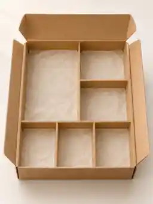
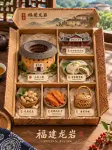

# 一城一盒｜实际生成案例

**生成日期：2026-11-05（北京时间）**。本主题于当天已有一张六格空白礼盒底板，以及龙岩、厦门、福州、北京、成都、巴黎等地区的独立3:4实际成图。每张独立图片展示一个城市的六件代表性风物、一个六格盒子及地域装饰。

> 进展：已上传7张来自用户当天真实生成原图的**低分辨率 WebP 预览**（模板、龙岩、厦门、福州、北京、成都、巴黎）。这些96×128或192×256的缩略图是源作品的下采样预览，绝不冒充1086×1448的原始 PNG。完整版仍待上传；其他城市成图尚未纳入本次预览。\n\n\n\n

## 用户已生成的视觉资产

- `六格空白伴手礼盒.png`：正式流程的空盒底板
- `福建龙岩客家文化礼盒.png`：六件客家风物，六个双语标签，地域盒盖与桌面
- `厦门海韵城市礼盒 diorama.png`：鼓浪屿建筑、南普陀、沙茶面等六件风物
- `福州文化珍藏礼盒全景.png`：三坊七巷、乌塔、鱼丸、茉莉茶等
- `北京匠心文化礼盒展陈.png`：天坛、长城、北京烤鸭、兔儿爷等
- `成都文化珍藏礼盒.png`：安顺廊桥、川味火锅、川剧、熊猫等
- `巴黎时光纪念礼盒.png`：埃菲尔铁塔、巴黎圣母院、可颂、马卡龙等

## 同一主题的排除项

- 九城拼贴图：属于对多个城市结果的汇总，**不作为本 Skill 的一城一盒单图合格案例**。
- 龙岩极简早期生成图：展示了首轮底板工作流，但升级后的精致版已有更完整的独立成图，避免将中间稿混作最终宣传样例。
- 同日GIF表情包、深度场双生创意方向：不属于此主题的最终成图。
